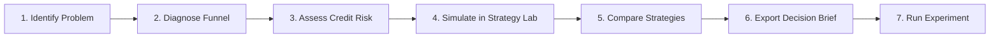
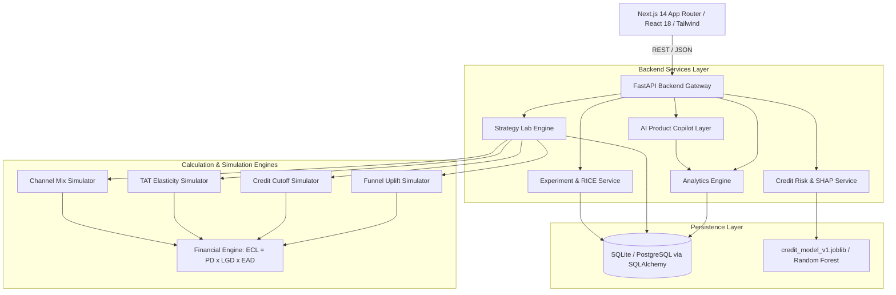
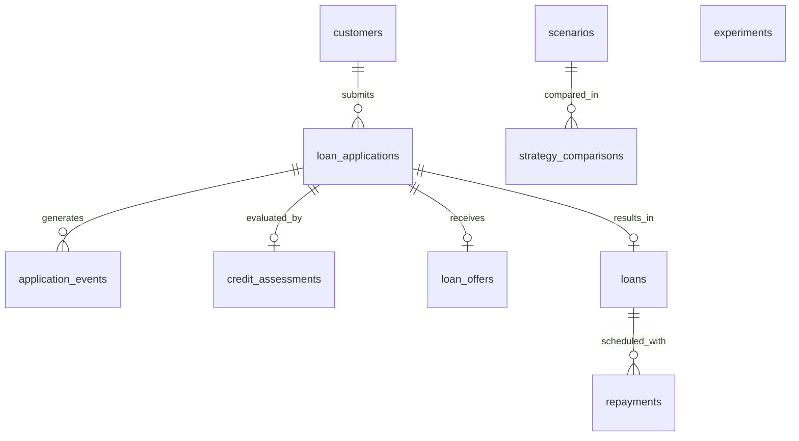
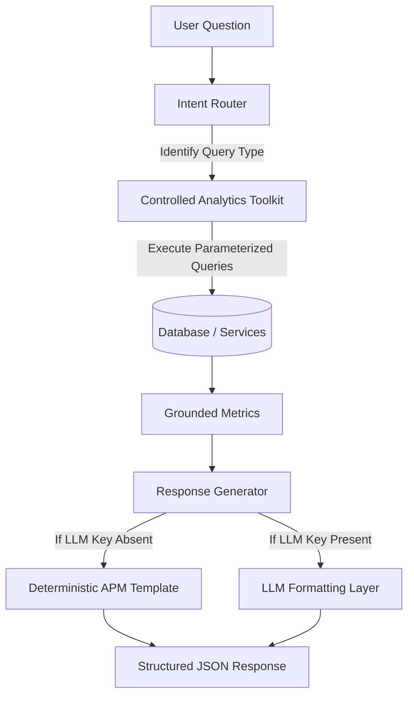

# LendLens
> **Turning Lending Data Into Smarter Product Decisions.**

[](LICENSE)
[](https://www.python.org/)
[](https://fastapi.tiangolo.com/)
[](https://nextjs.org/)
[](backend/tests/)

LendLens is a production-quality **FinTech Product Intelligence and Decision Support Platform** engineered for Associate Product Managers (APMs), Lending Business Analysts, and Credit Risk Teams at retail banking institutions.

Rather than presenting isolated, static dashboards, LendLens bridges customer acquisition funnels, machine-learning credit risk scoring, and loan portfolio economics through an interactive **Strategy Lab** simulation engine and an **AI Product Copilot** with a 100% deterministic fallback.

---

## Table of Contents
1. [Problem Statement & Product Vision](#1-problem-statement--product-vision)
2. [APM Decision-Making Workflow](#2-apm-decision-making-workflow)
3. [Key Platform Features](#3-key-platform-features)
4. [System Architecture](#4-system-architecture)
5. [Technology Stack](#5-technology-stack)
6. [Database Schema & Entity Relationship](#6-database-schema--entity-relationship)
7. [Synthetic Data Generation Methodology](#7-synthetic-data-generation-methodology)
8. [KPI Definitions & Metric Formulas](#8-kpi-definitions--metric-formulas)
9. [Credit Risk Modeling & Explainable AI (SHAP)](#9-credit-risk-modeling--explainable-ai-shap)
10. [Strategy Lab: Simulation & Financial Engine](#10-strategy-lab-simulation--financial-engine)
11. [AI Product Copilot Architecture](#11-ai-product-copilot-architecture)
12. [Product Experimentation & RICE Prioritization](#12-product-experimentation--rice-prioritization)
13. [Local Development Setup](#13-local-development-setup)
14. [Testing Suite](#14-testing-suite)
15. [Deployment Guide](#15-deployment-guide)
16. [Known Limitations & Responsible FinTech Design](#16-known-limitations--responsible-fintech-design)
17. [Future Roadmap](#17-future-roadmap)

---

## 1. Problem Statement & Product Vision

Digital lending product teams must constantly balance five conflicting objectives:
1. **Maximize Application Throughput**: Accelerate customer completion without funnel drop-offs.
2. **Eliminate Customer Friction**: Streamline document submission and KYC without compliance breaches.
3. **Calibrate Credit Risk**: Approve creditworthy borrowers while containing default probabilities.
4. **Protect Unit Economics**: Ensure interest income and origination fees exceed cost of funds, CAC, and Expected Credit Loss (ECL).
5. **Comply with Responsible Lending Standards**: Prevent discriminatory outcomes and avoid over-leveraging vulnerable borrowers.

Traditional business intelligence tools display historical lag indicators (e.g., "Disbursals dropped 8% last month") but fail to diagnose the root cause or evaluate the financial consequences of proposed product changes.

**LendLens solves this by turning retrospective data into simulated product decisions.**

---

## 2. APM Decision-Making Workflow

LendLens is architected around the core product management loop:



1. **Identify Problem**: Spot conversion dips or delinquency spikes on the **Executive Overview** (`/dashboard`).
2. **Diagnose Funnel**: Pinpoint high-friction stages (e.g., KYC drop-off in Aggregator channels) on the **Customer Journey** page (`/customer-journey`).
3. **Assess Credit Risk**: Examine risk distributions, benchmark cutoff trade-offs, and inspect individual borrower SHAP attributions in **Credit Intelligence** (`/credit-intelligence`).
4. **Simulate in Strategy Lab**: Model the downstream P&L impact of a 5% KYC uplift, a 50 bps risk cutoff shift, or an acquisition mix rebalance in the **Strategy Lab** (`/strategy-lab`).
5. **Compare Strategies**: Benchmark multiple saved scenarios side-by-side against the live portfolio baseline.
6. **Export Decision Brief**: Automatically generate an executive-ready 12-section **Product Decision Brief** with clear recommendations and guardrail metrics.
7. **Run Experiment**: Track the intervention, hypothesis, sample size, and RICE priority in **Product Experimentation** (`/experiments`).

---

## 3. Key Platform Features

- **Executive Overview (`/dashboard`)**: Real-time aggregated metrics (Applications, Completion Rate, Approval Rate, Disbursal Volume, Delinquency, Net Losses) with acquisition channel and cohort breakdown.
- **Customer Journey & Funnel Intelligence (`/customer-journey`)**: 7-stage micro-conversion analysis, median stage turnaround time (TAT), drop-off diagnostics, and one-click hypothesis creation.
- **Credit Risk Intelligence (`/credit-intelligence`)**: Validated Machine Learning model evaluation (ROC-AUC 0.9144, Recall 96.33%), fairness diagnostics across customer segments, interactive borrower risk scoring sandbox, and local SHAP feature explanations.
- **Lending Portfolio Analytics (`/portfolio`)**: Vintage delinquency analysis, aging schedules (Current, 1-30 DPD, 31-60 DPD, 61-90 DPD, Default 90+), PAR30/60/90 metrics, and principal recovery curves.
- **Strategy Lab Simulator (`/strategy-lab`)**: What-If scenario engine supporting Funnel Optimization, Credit Cutoff Sensitivity, TAT Elasticity, and Channel Mix adjustments with automated P&L contribution calculations.
- **Automated Product Decision Brief Generator**: Generates 12-section APM briefs with baseline comparison, assumptions, financial projections, guardrails, and validation plans.
- **AI Product Copilot (`/copilot`)**: Conversational product copilot backed by a controlled analytical tools layer, parameter-checked queries, and a 100% deterministic fallback (zero reliance on paid external APIs).
- **Product Experimentation Workspace (`/experiments`)**: Full lifecycle management (Draft, Running, Completed) with transparent RICE prioritization scoring and guardrail metric tracking.

---

## 4. System Architecture



### Security & Integrity Principles
- **No Direct SQL Execution**: The AI Copilot uses `ControlledAnalyticsToolkit` (parameterized method calls). It never executes LLM-generated raw SQL.
- **Zero Target Leakage**: Machine learning features are strictly constrained to application-time attributes. Post-disbursal repayment behavior is completely isolated during model training.
- **Relational Integrity**: Foreign keys, check constraints, and cascade relationships enforce that every disbursed loan maps to an eligible, approved application state.

---

## 5. Technology Stack

| Layer | Technology | Rationale |
| :--- | :--- | :--- |
| **Frontend** | Next.js 14 (App Router), TypeScript, Tailwind CSS | Server-side rendering, component-driven modularity, type safety, responsive layout. |
| **Data Visualization** | Recharts, Lucide React | Clean, responsive charting with interactive tooltips, area curves, and bar breakdowns. |
| **Backend API** | FastAPI (Python 3.10+), Pydantic v2 | High-throughput asynchronous REST API, automated OpenAPI documentation, strict request/response schema validation. |
| **Database & ORM** | SQLAlchemy 2.0, Alembic, SQLite / PostgreSQL | Relational transactional persistence, clean migrations, portable across local dev and cloud deployments. |
| **Machine Learning** | Scikit-learn, NumPy, Pandas, SHAP, Joblib | Validated credit classification pipeline, reproducible train/validation/test splits, tree-based explainability. |
| **Financial Engine** | Deterministic Python Module (`financial_engine.py`) | Mathematically rigorous ECL provisioning, Net Interest Margin (NIM), and operational cost modeling. |
| **Testing** | Pytest, HTTPX | Comprehensive unit, analytical, ML validation, and end-to-end integration test suites. |

---

## 6. Database Schema & Entity Relationship

LendLens uses a normalized 9-table relational database schema:



1. **`customers`**: Demographics, income bands, monthly income, bureau credit score, debt-to-income ratio.
2. **`loan_applications`**: Requested principal, tenure, acquisition channel, current stage status, timestamps.
3. **`application_events`**: Timestamped funnel events (`APPLICATION_STARTED`, `DETAILS_SUBMITTED`, `KYC_COMPLETED`, `CREDIT_ASSESSED`, `LOAN_APPROVED`, `OFFER_ACCEPTED`, `LOAN_DISBURSED`).
4. **`credit_assessments`**: Algorithmic model version, predicted Probability of Default (PD), assessment timestamps.
5. **`loan_offers`**: Offered principal, tenure, annual interest rate, expiration status.
6. **`loans`**: Disbursed principal, active status, maturity date, interest rate.
7. **`repayments`**: Amortized monthly installments, due dates, payment dates, amounts due/paid, delinquency status.
8. **`scenarios`**: Saved Strategy Lab assumptions and computed P&L contribution JSON.
9. **`experiments`**: A/B test definitions, hypotheses, RICE scores, and guardrail metrics.

Detailed field definitions and constraints are documented in [docs/data-dictionary.md](docs/data-dictionary.md).

---

## 7. Synthetic Data Generation Methodology

To ensure realistic banking analytics without exposing sensitive PII, LendLens incorporates a reproducible data synthesis engine (`backend/app/db/seed_data.py`):

- **Volume**: 10,000 synthetic customers, 10,000 applications, 42,471 journey events, 3,502 disbursed loans, and 95,244 monthly repayments.
- **Time Distribution**: Multi-month observation window generating realistic daily and weekly lending cycles.
- **Correlated Risk Profiles**:
  - Higher DTI and lower bureau scores realistically correlate with elevated default probabilities.
  - Channel-specific conversion variance (Organic channels exhibit higher completion rates; Aggregators show higher drop-off at KYC).
- **Repayment Simulation**:
  - Amortized reducing-balance Equated Monthly Installments (EMI).
  - Transition matrices generating on-time payments, 30/60/90-day delinquencies, and defaults.
- **Data Integrity**: Enforced by `DataIntegrityValidator`, confirming zero orphan records, strictly monotonic event sequences, and valid stage progression.

---

## 8. KPI Definitions & Metric Formulas

| Metric | Definition & Denominator | Target / Benchmark |
| :--- | :--- | :--- |
| **Application Completion Rate** | $\frac{\text{Completed Applications (Details Submitted)}}{\text{Total Applications Initiated}}$ | ~70% - 85% |
| **KYC Completion Rate** | $\frac{\text{KYC Completed Events}}{\text{Details Submitted Applications}}$ | ~60% - 75% |
| **Approval Rate** | $\frac{\text{Credit Approved Applications}}{\text{Credit Assessed Applications}}$ | ~40% - 60% |
| **Offer Acceptance Rate** | $\frac{\text{Offers Accepted}}{\text{Offers Generated}}$ | ~75% - 85% |
| **Disbursal Conversion Rate** | $\frac{\text{Loans Disbursed}}{\text{Total Applications Initiated}}$ | ~30% - 40% |
| **PAR30 (Portfolio at Risk 30+)** | $\frac{\text{Outstanding Principal on Loans with 30+ DPD}}{\text{Total Active Portfolio Principal}}$ | < 4.0% |
| **Default Rate** | $\frac{\text{Loans with 90+ DPD or Written-Off}}{\text{Total Matured Disbursed Loans}}$ | < 3.0% |
| **Net Financial Contribution** | $\text{Interest Revenue} + \text{Origination Fees} - \text{Funding Cost} - \text{CAC} - \text{ECL}$ | Positive Margin |

Full mathematical derivations and edge-case handling are documented in [docs/metrics-glossary.md](docs/metrics-glossary.md).

---

## 9. Credit Risk Modeling & Explainable AI (SHAP)

LendLens implements an end-to-end machine learning pipeline (`backend/app/ml/`):

### Model Comparison & Performance
A baseline Logistic Regression was benchmarked against a non-linear Random Forest classifier using an out-of-time (OOT) temporal split:

| Model Architecture | ROC-AUC | Precision | Recall | F1-Score | Brier Score | Decision |
| :--- | :---: | :---: | :---: | :---: | :---: | :---: |
| **Logistic Regression (Baseline)** | 0.9256 | 0.5841 | 0.8163 | 0.6810 | 0.0892 | Baseline Benchmark |
| **Random Forest (Champion)** | **0.9144** | **0.5178** | **0.9633** | **0.6738** | **0.2094** | **Production Champion** |

> **APM Rationale**: In retail unsecured lending, a **False Negative** (approving a borrower who defaults, losing 100% principal) is significantly costlier than a **False Positive** (rejecting an applicant, losing marginal interest). The Random Forest model captures **96.33% of all defaults** (Recall), drastically mitigating bad-debt exposure.

### Model Explainability (SHAP)
- **Global Feature Importance**: Debt-to-Income (DTI), Bureau Credit Score, and Monthly Income represent >70% of feature attribution.
- **Local SHAP Attributions**: Every inference request returns exact positive/negative risk drivers, enabling transparent decision-making and compliance auditability.

Complete model methodology, training data, and fairness diagnostics are in [docs/ml-model-card.md](docs/ml-model-card.md).

---

## 10. Strategy Lab: Simulation & Financial Engine

The **Strategy Lab** (`/strategy-lab`) is LendLens's primary differentiator. It enables product managers to evaluate hypothetical product changes before committing engineering or marketing capital.

### Supported Simulation Modules
1. **Funnel Stage Improvement**: Simulates conversion lifts at specific journey bottlenecks (e.g. KYC, Offer Acceptance). Downstream volumes propagate dynamically through historical conversion probabilities.
2. **Credit Cutoff Sensitivity**: Models adjustments to the risk threshold (Probability of Default cutoff). Displays volume changes, expected default rates, and incremental credit loss.
3. **Turnaround Time (TAT) Elasticity**: Models conversion changes driven by processing speed improvements.
4. **Acquisition Channel Mix**: Simulates reallocating marketing spend across Organic, Paid Search, Aggregators, and Partner channels.

### Transparent Financial Engine Formula
$$\text{Expected Credit Loss (ECL)} = \text{Probability of Default (PD)} \times \text{Loss Given Default (LGD)} \times \text{Exposure at Default (EAD)}$$
$$\text{Gross Revenue} = \text{Annual Interest Margin} + \text{Origination Fee (1.5\%)}$$
$$\text{Cost of Funds} = \text{Disbursed Principal} \times 6.5\% \text{ Cost of Capital}$$
$$\text{Net Contribution} = \text{Gross Revenue} - \text{Cost of Funds} - \text{Total CAC} - \text{Operating Costs} - \text{ECL}$$

Users can save scenarios, run sensitivity curves across parameters, compare multiple strategies side-by-side, and generate full **Product Decision Briefs**.

---

## 11. AI Product Copilot Architecture

The **AI Product Copilot** (`/copilot`) provides interactive analytical assistance without hallucinations or security risks:



### Key Guarantees
- **100% Deterministic Fallback**: Operates out of the box with zero external API keys. Recognizes queries regarding funnels, channels, credit risk, delinquency, and strategy comparison.
- **No Hallucinated Metrics**: Every figure cited in responses is extracted directly from the underlying database or ML evaluation pipeline.
- **Structured APM Output**: Returns Direct Answer, Ground-Truth Metrics, Analytical Interpretation, Known Limitations, and Actionable Next Steps.

---

## 12. Product Experimentation & RICE Prioritization

The **Product Experimentation Workspace** (`/experiments`) enables product teams to transition from simulated strategies to structured in-market A/B tests.

- **Experiment Status Tracking**: `Draft`, `Planned`, `Running`, `Completed`, `Paused`.
- **RICE Scoring Engine**:
  $$\text{RICE Score} = \frac{\text{Reach} \times \text{Impact (1-5)} \times \text{Confidence (\%)}}{\max(0.5, \text{Effort in Person-Months})}$$
- **Guardrail Metrics**: Tracks secondary metrics (e.g., maintaining PAR30 < 3.5%) to ensure conversion gains do not compromise credit quality.

---

## 13. Local Development Setup

### Prerequisites
- Python 3.10+ (Tested on Python 3.14)
- Node.js 18+ & npm
- Git

### Step-by-Step Installation

#### 1. Clone Repository
```bash
git clone https://github.com/vanshita2608-c/LendLens.git
cd LendLens
```

#### 2. Backend Setup
```bash
cd backend
python3 -m venv venv
source venv/bin/activate
pip install -r requirements.txt
```

#### 3. Database Migration & Synthetic Seeding
```bash
# Seed 10,000 customers, 42k+ events, and repayment schedules into lendlens.db
python -m app.db.seed_data
```

#### 4. Run Backend Server
```bash
uvicorn app.main:app --host 0.0.0.0 --port 8000 --reload
```
API Documentation will be available at: [http://localhost:8000/docs](http://localhost:8000/docs)

#### 5. Frontend Setup
In a new terminal:
```bash
cd frontend
npm install
npm run dev
```
Open [http://localhost:3000](http://localhost:3000) to access the LendLens application.

---

## 14. Testing Suite

The platform includes an automated testing suite covering unit math, database integrity, machine learning leakage, and end-to-end workflows.

### Running Backend & Analytical Tests
```bash
# From workspace root
PYTHONPATH=backend backend/venv/bin/pytest backend/tests/ -v
```

**Results: 68/68 passed** across 28 test suites in ~2.3 seconds:
- `test_analytics.py`: KPI calculations, cohort conversion, zero-division edge cases.
- `test_financial_engine.py`: ECL formula, Net Interest Margin, cost of funds.
- `test_simulations.py`: Funnel propagation, credit cutoff shifts, channel mix.
- `test_credit_model.py`: Temporal leakage checks, feature transformation, inference validation.
- `test_copilot.py`: Deterministic fallback, tool parameter validation, SQL injection safety.
- `test_e2e_workflow.py`: Complete 10-step APM journey from dashboard diagnosis to decision brief generation.

### Running Frontend Production Build & Typechecks
```bash
cd frontend
npm run build
```
Validates zero TypeScript errors, successful static generation of all 12 routes, and CSS optimization.

---

## 15. Deployment Guide

### Monorepo Containerization (Docker Compose)
LendLens provides a `docker-compose.yml` configuration:
```bash
docker-compose up --build
```
- Spins up PostgreSQL database on port 5432.
- Launches FastAPI backend on port 8000 with connection pooling.
- Builds and serves Next.js frontend on port 3000.

### Cloud Deployment
- **Frontend**: Deployable directly to **Vercel** with zero configuration. Set `NEXT_PUBLIC_API_URL` to your backend URL.
- **Backend**: Containerized deployment to **AWS ECS**, **Render**, or **GCP Cloud Run**. Set `DATABASE_URL` to managed PostgreSQL.

---

## 16. Known Limitations & Responsible FinTech Design

- **Synthetic Data**: All applicants, financial indicators, and repayment histories are synthetically generated for educational and evaluation purposes.
- **Stationary Distribution**: Simulations assume downstream conversion rates remain constant during upstream volume increases.
- **Correlation vs. Causation**: Turnaround time (TAT) elasticity is simulated based on observational correlation; actual product interventions require randomized A/B experimentation.
- **Ethical Lending & Non-Discrimination**: Demographic attributes (gender, marital status, location) are strictly excluded from credit scoring features to eliminate bias.

Read full disclosures in [docs/risk-and-limitations.md](docs/risk-and-limitations.md).

---

## 17. Future Roadmap

1. **Alternative Data Ingestion**: Integration of consent-based Account Aggregator (AA) banking statement parsers.
2. **Dynamic Pricing Engine**: Automated risk-based interest rate elasticity modeling.
3. **Automated Loss Forecasting**: Multi-state Markov Chain credit migration modeling for CECL/IFRS 9 compliance.
4. **Real-time Feature Store**: Low-latency feature caching via Redis for real-time application fraud scoring.

---

## Author & APM Portfolio Context

Developed by **Vanshita Shah** as a comprehensive portfolio project demonstrating end-to-end capabilities across:
- **Product Strategy & APM Thinking**
- **FinTech Domain Fundamentals & Digital Lending Economics**
- **Relational Database Design & High-Performance SQL**
- **Machine Learning & Explainable AI (SHAP)**
- **Modern Full-Stack Engineering (Next.js, TypeScript, FastAPI)**

*For questions, collaboration, or feedback, please reach out via GitHub or LinkedIn.*
