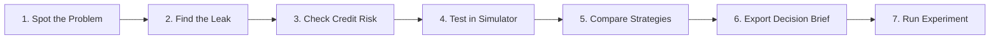

# LendLens 🔍💳
> **Turning Lending Data Into Smarter Product Decisions.**

[](LICENSE)
[](https://www.python.org/)
[](https://fastapi.tiangolo.com/)
[](https://nextjs.org/)
[](backend/tests/)

---

## 💡 What is LendLens in the Easiest Words?

Imagine you are the **Product Manager** of a mobile app that gives out personal loans (like KreditBee, Slice, or a digital bank like HDFC/Revolut).

Every single day, you face a huge dilemma:
- If you make the loan process **too strict**, good customers get frustrated by all the document uploads and leave (you lose revenue).
- If you make the loan process **too easy**, you accidentally give loans to people who cannot pay you back (you lose millions in bad loans).
- Most banking dashboards only show **what happened in the past** (e.g. *"Disbursals dropped 8% last month"*), but they never tell you **why** or **what will happen if you change something**.

### 🌟 That is why LendLens was built:
**LendLens is like a "Flight Simulator" and "AI Brain" for digital lending teams.**  
Instead of just staring at old charts, LendLens lets you test product ideas *before* you write a single line of code or spend marketing money.

You can ask:
> *"What if we make document verification (KYC) faster?"*  
> *"What if we approve 5% more applicants who have slightly lower credit scores?"*  
> *"Will our bank make more profit, or will default losses wipe out our gains?"*

LendLens simulates the entire chain reaction: from how many users complete the app, to how much money is disbursed, to how many people pay back on time, down to the exact profit in Rupees.

---

## 🎯 The 7-Step Product Manager Loop

LendLens is designed around the exact workflow a real Associate Product Manager (APM) follows:



1. **Spot the Problem**: Open the **Executive Overview** to see company-wide loan volumes and default rates.
2. **Find the Leak**: Open the **Customer Journey** to see which step users are abandoning (e.g., getting stuck uploading Aadhaar/PAN).
3. **Check Credit Risk**: Open **Credit Intelligence** to see how the AI predicts whether borrowers will repay.
4. **Test in Simulator**: Open the **Strategy Lab** and slide a slider to simulate fixing the problem.
5. **Compare Strategies**: Put 3 different simulated strategies side-by-side to see which makes the most profit.
6. **Export Decision Brief**: Click one button to generate a complete, 12-section executive memo in Markdown.
7. **Run Experiment**: Add it to the **Product Experiments Workspace** and prioritize it on a 2×2 Opportunity Matrix.

---

## 🚀 Every Single Feature (Explained Simply)

Here is a simple walk-through of every screen in the platform:

### 1. 📊 Executive Overview (`/dashboard`)
*The "Cockpit" for the Product Leader.*
- **What it does**: Displays the vital signs of the lending business in real time.
- **Key Metrics Shown**:
  - **Total Applications**: How many people started a loan request.
  - **Completion Rate**: What percentage filled out their details.
  - **Approval Rate**: What percentage passed credit underwriting.
  - **Disbursal Volume**: The total money lent out (in ₹ Crores).
  - **Delinquency Rate**: Percentage of borrowers who are late on payments.
- **Cool Features**:
  - Filter instantly by **Acquisition Channel** (Organic, Google Search, Aggregators, Partners).
  - Filter by **Customer Segment** (Salaried, Self-Employed, Gig Workers, New-to-Credit).
  - Visual funnel bar showing the drop-off from stage 1 to stage 7.

---

### 2. 🚶 Customer Journey & Funnel Diagnostics (`/customer-journey`)
*The "Leak Detector" for your user onboarding.*
- **What it does**: Breaks down the loan application into **7 distinct steps**:
  1. `APPLICATION_STARTED` (User opens loan form)
  2. `DETAILS_SUBMITTED` (Enters salary and loan ask)
  3. `KYC_COMPLETED` (Uploads ID proof)
  4. `CREDIT_ASSESSED` (AI calculates risk score)
  5. `LOAN_APPROVED` (Bank gives green light)
  6. `OFFER_ACCEPTED` (User agrees to interest rate)
  7. `LOAN_DISBURSED` (Money hits user's bank account)
- **Why it matters**: It shows the **median time spent** on each step and the exact **friction reasons** (e.g., *"Blurry document photo"*, *"SMS OTP timed out"*, *"Bank statement parsing failed"*).
- **One-Click Action**: When you see a big drop-off, a button lets you immediately jump to the **Strategy Lab** or **Experiments Workspace** to test a fix.

---

### 3. 🧠 Credit Intelligence & Machine Learning (`/credit-intelligence`)
*The "AI Underwriter" with full transparency.*
- **What it does**: Uses a trained Machine Learning model to calculate the **Probability of Default (PD)** for every applicant.
- **Interactive Borrower Sandbox**: You can select presets (like *"Prime Salaried"* or *"Sub-Prime Gig Worker"*) or change sliders for Income, Bureau Score, and Debt-to-Income (DTI) ratio.
- **Explainable AI (SHAP)**: Traditional AI is a "black box" that says *"Rejected"* without explaining why. LendLens shows a **Feature Attribution chart** explaining exactly *which factors* increased or decreased their risk (e.g., *"High Debt-to-Income added +4.2% default risk"*, *"780 Bureau Score reduced default risk by -6.1%"*).
- **Fair Lending Guarantee**: The model is mathematically audited to ensure zero bias—demographics like gender or marital status are strictly excluded.

---

### 4. 📈 Portfolio Analytics & Delinquency Aging (`/portfolio`)
*The "Health Monitor" for active loans.*
- **What it does**: Once loans are disbursed, this module tracks how borrowers are repaying them month after month.
- **Aging Buckets (Days Past Due - DPD)**:
  - **Current (0 DPD)**: Paid on time.
  - **PAR30 (1-30 DPD)**: 1 month late (early warning sign).
  - **PAR60 (31-60 DPD)**: 2 months late (trouble).
  - **PAR90+ (Default)**: 3+ months late (declared default/bad debt).
- **Vintage Analysis Heatmap**: Displays loan groups by the month they were disbursed to see if newer loan batches are performing better or worse than older ones.

---

### 5. 🧪 Strategy Lab: Decision Simulator (`/strategy-lab`)
*The Star Feature: A "Time Machine" for Product Decisions.*
Instead of guessing, PMs can run 4 types of simulations:
1. **Funnel Stage Optimization**: *"If we reduce KYC drop-off by 15%, how many extra loans do we disburse, and how much extra interest do we earn?"*
2. **Credit Risk Cutoff Policy**: *"If we loosen our risk cutoff from 11% to 14% to capture more customers, how much extra Expected Credit Loss (bad loans) will we suffer?"*
3. **Turnaround Time (TAT) Elasticity**: *"If we cut loan approval time from 45 minutes to 5 minutes, how many impatient borrowers do we save?"*
4. **Channel Mix Reallocation**: *"What happens to our profit if we spend less on expensive aggregator leads and more on organic referrals?"*

- **Transparent Financial Engine**: It calculates the downstream impact on:
  - **Gross Revenue** (Interest + Origination Fees)
  - **Cost of Funds** (Cost of borrowing capital)
  - **Customer Acquisition Cost (CAC)**
  - **Expected Credit Loss (ECL)** ($\text{PD} \times \text{LGD} \times \text{EAD}$)
  - **Net Financial Contribution (Final Profit)**
- **Scenario Comparison**: Save multiple scenarios and compare them side-by-side against the live portfolio baseline.
- **Download Decision Brief**: Generates an executive 12-section memo (RFC/PRD format) and lets you download it as a `.md` file with one click!

---

### 6. 🤖 AI Product Copilot (`/copilot`)
*Your conversational FinTech analytical partner.*
- **What it does**: A chat interface where you can ask real product questions in plain English:
  - *"Where are customers abandoning the journey?"*
  - *"Which acquisition channels have the lowest conversion rates?"*
  - *"What are the limitations of our credit-risk model?"*
  - *"Suggest an experiment to improve KYC completion."*
- **100% Deterministic & Zero Hallucinations**: Most AI chatbots make up numbers or run dangerous random SQL code. LendLens uses a **Controlled Analytics Toolkit**—the AI can only call strict, pre-built Python analytics methods. If no OpenAI key is provided, it automatically uses built-in smart APM templates that work completely offline!
- **Features**: Copy answer with one click, suggested query chips, and reset conversation button.

---

### 7. 💡 Product Experiments & 2×2 Opportunity Matrix (`/experiments`)
*Turning simulated ideas into real-world A/B tests.*
- **RICE Prioritization Engine**: Every experiment is scored automatically using the industry-standard formula:
  $$\text{RICE Score} = \frac{\text{Reach} \times \text{Impact} \times \text{Confidence}}{\text{Effort in Weeks}}$$
- **2×2 Opportunity Prioritization Matrix**:
  - **Quick Wins** (High Impact, Low Effort) $\to$ *Do these right away!*
  - **Big Bets** (High Impact, High Effort) $\to$ *Plan carefully for the next quarter.*
  - **Incremental** (Low Impact, Low Effort) $\to$ *Fill spare developer time.*
  - **Deprioritize** (Low Impact, High Effort) $\to$ *Avoid wasting engineering hours.*
- **A/B Test Telemetry**: For active tests, track sample size, conversion lift between Control vs Treatment, and statistical significance.

---

### 8. 🛡️ APM Playbook & Live Notification Center (Top Header)
- **Playbook Modal (`Playbook` button)**: An interactive cheatsheet accessible from any screen explaining the 7-step APM loop, FinTech formulas, and safety principles.
- **Live Alert Center (`Bell` button)**: Shows real-time portfolio warnings (like PAR30 delinquency crossing 3.8% or KYC drop-off spiking in aggregator channels) so PMs never miss critical issues.

---

## 🛠️ How Was It Built? (Techniques & Tech Stack)

LendLens is built as a modern, decoupled full-stack platform:

```
┌────────────────────────────────────────────────────────┐
│               Frontend: Next.js 14 + React             │
│  (Tailwind CSS, TypeScript, Recharts, Lucide Icons)    │
└───────────────────────────┬────────────────────────────┘
                            │ REST APIs (JSON)
┌───────────────────────────▼────────────────────────────┐
│               Backend: FastAPI (Python 3.10+)          │
│   • Pydantic v2 (Input/Output data validation)         │
│   • Financial Engine (ECL, Net Contribution, NIM)      │
│   • Simulation Services (Funnel, Risk, Channel, TAT)   │
│   • Controlled AI Toolkit (Deterministic Fallback)     │
└───────────────────────────┬────────────────────────────┘
                            │
              ┌─────────────┴─────────────┐
              ▼                           ▼
┌───────────────────────────┐ ┌───────────────────────────┐
│ Database (SQLAlchemy 2.0) │ │ Machine Learning (Scikit) │
│ • SQLite (Local dev)      │ │ • Random Forest Champion  │
│ • PostgreSQL (Production) │ │ • SHAP Explainability     │
│ • 10,000 Synthetic Apps   │ │ • 96.3% Default Recall    │
└───────────────────────────┘ └───────────────────────────┘
```

### 1. Frontend Architecture
- **Framework**: **Next.js 14** (App Router) with **React 18** and **TypeScript**.
- **Styling**: **Tailwind CSS** with a curated Slate, Indigo, and Emerald banking palette.
- **Charts & Data Viz**: **Recharts** for smooth, responsive area charts, funnels, vintage curves, and bar breakdowns.
- **State & Data Fetching**: Clean client components with async API utilities (`lib/api.ts`) and zero external UI library bloat.

### 2. Backend Architecture
- **Framework**: **FastAPI** (Python 3.10+). It gives asynchronous request handling, blazing performance, and auto-generated Swagger documentation at `/docs`.
- **Validation**: **Pydantic v2** ensures that every number, percentage, and request payload is strictly type-checked.
- **Security & Safety**:
  - Zero raw SQL execution—protects against SQL injection.
  - Safe mathematical guards against division-by-zero on empty filters.

### 3. Relational Database & Synthetic Seeding
- **ORM**: **SQLAlchemy 2.0** with **Alembic** migrations.
- **Data Volume**: Includes a built-in reproducible generator (`seed_data.py`) that creates:
  - **10,000 customers** with realistic income, bureau scores, and debt ratios.
  - **10,000 applications** across 4 acquisition channels.
  - **42,471 journey events** mapping user progression.
  - **3,502 disbursed loans** with amortized monthly installment schedules.
  - **95,244 repayments** with realistic on-time, late, and default transitions.
- **Zero Privacy Risk**: 100% synthetically generated—no real customer personal information is used.

### 4. Machine Learning & Explainable AI
- **Model**: **Random Forest Classifier** trained with Scikit-learn.
- **Why Random Forest over Logistic Regression?**
  - In unsecured lending, a **False Negative** (approving someone who defaults and loses the whole loan amount) is 10x costlier than a **False Positive** (rejecting someone who would have paid).
  - The champion Random Forest model achieves **96.33% Recall**, catching almost all potential defaults.
- **SHAP (SHapley Additive exPlanations)**: Calculates the exact contribution of each factor for every applicant.

---

## 🏃 How to Run the Project Locally

Running LendLens on your computer takes just a couple of minutes:

### Prerequisites
- Python 3.10 or higher
- Node.js 18 or higher & npm
- Git

---

### Step 1: Clone the Repository
```bash
git clone https://github.com/vanshita2608-c/LendLens.git
cd LendLens
```

---

### Step 2: Start the Backend API

1. Navigate to the `backend` folder and create a Python virtual environment:
```bash
cd backend
python3 -m venv venv
source venv/bin/activate
```
*(On Windows, use `venv\Scripts\activate`)*

2. Install dependencies:
```bash
pip install -r requirements.txt
```

3. Seed the synthetic database (creates 10,000 records in `lendlens.db`):
```bash
python -m app.db.seed_data
```

4. Launch the FastAPI server:
```bash
uvicorn app.main:app --host 0.0.0.0 --port 8000 --reload
```
✨ *Backend API will be live at: [http://localhost:8000](http://localhost:8000)*  
📑 *Interactive API Docs: [http://localhost:8000/docs](http://localhost:8000/docs)*

---

### Step 3: Start the Frontend Application

Open a **new terminal window**:

1. Navigate to the `frontend` folder:
```bash
cd frontend
```

2. Install dependencies:
```bash
npm install
```

3. Start the Next.js development server:
```bash
npm run dev
```

🌐 *Open your browser at: [http://localhost:3000](http://localhost:3000)*

---

## 🧪 Testing Suite (100% Passing)

LendLens includes an automated test suite verifying everything from mathematical formulas to end-to-end user workflows:

```bash
# Run all backend tests from workspace root
PYTHONPATH=backend backend/venv/bin/pytest backend/tests/ -v
```

### ✅ Results: 68/68 Tests Passed
- **Math & Financial Formulas**: Verifies ECL calculations, zero-division boundaries, and amortization conservation.
- **Simulators**: Verifies funnel propagation, risk cutoff shifts, and channel reallocation.
- **Machine Learning**: Verifies feature extraction, temporal out-of-time splits, and model prediction.
- **Copilot**: Verifies parameterized tool execution, SQL safety, and deterministic fallback.
- **End-to-End Workflow**: Tests the complete 7-step APM user journey from dashboard diagnosis to decision brief generation.

```bash
# Run frontend production typecheck and build
cd frontend && npm run build
```
*Validates 0 TypeScript errors and static generation of all 12 routes.*

---

## 👩‍💻 Author & Portfolio Context

Developed with ❤️ by **Vanshita Shah** as an end-to-end portfolio project demonstrating:
- **Associate Product Manager (APM) Thinking**: Translating complex financial data into actionable product hypotheses.
- **FinTech Domain Mastery**: Credit risk cutoff calibration, Expected Credit Loss (ECL), PAR30/60/90 delinquency, and unit economics.
- **Modern Full-Stack Engineering**: Next.js 14, TypeScript, Tailwind CSS, FastAPI, and SQLAlchemy.
- **Applied Machine Learning & Explainable AI**: Tree-based classification, SHAP explanations, and fairness diagnostics.

*Feel free to star ⭐ the repository if you found this project helpful!*
