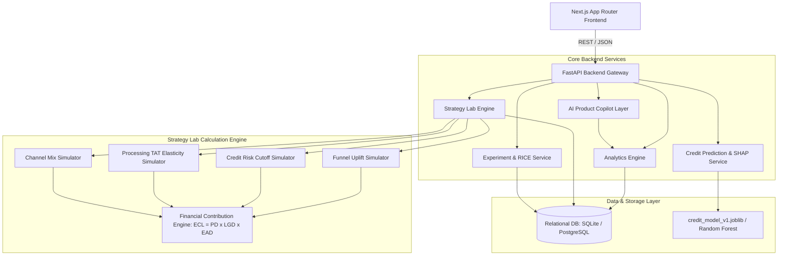

# LendLens Architecture & System Design Specification

## 1. System Overview

LendLens is an integrated Digital Lending Product Intelligence and Decision Support Platform engineered for retail banking Product Managers, Credit Risk Analysts, and Operations Leaders.

The platform links top-of-funnel customer journey analytics with bottom-of-funnel credit underwriting risk and lending portfolio economics through a dynamic **Strategy Lab** simulation engine.

---

## 2. Technology Stack & Responsibilities

| Layer | Technology | Primary Responsibility |
| :--- | :--- | :--- |
| **Frontend** | Next.js 14 (App Router), TypeScript, Tailwind CSS, Recharts | Executive dashboards, interactive sandbox sliders, Recharts data visualization, decision brief viewing. |
| **Backend API** | Python 3.14, FastAPI, Pydantic v2 | High-throughput async REST endpoints, request validation, pagination, CORS handling. |
| **Database** | SQLAlchemy 2.0, Alembic, SQLite / PostgreSQL | Relational transactional persistence, indexed foreign keys, cascade constraints. |
| **Machine Learning** | Scikit-Learn, SHAP, Joblib | Default probability prediction, temporal OOT evaluation, SHAP local attributions. |
| **Strategy Engine** | NumPy, Pandas, Custom Financial Engine | Real-time unit economics (Net Interest Margin, ECL provisioning, variable CAC). |
| **AI Copilot** | Controlled Analytics Toolkit | Grounded natural language interpretation with 100% deterministic fallback. |

---

## 3. Data Flow & Security Principles

### 3.1 Zero Target Leakage in ML
Features used by the credit risk prediction engine (`CreditFeaturePipeline`) are strictly restricted to application-time attributes:
- Monthly net income, bureau credit score, debt-to-income ratio (DTI), requested principal, and tenure.
- All post-disbursal performance data (repayment dates, delinquent installments, write-offs) are strictly isolated from the training feature matrix.

### 3.2 Controlled Analytics Layer (No Arbitrary SQL)
The AI Product Copilot does not possess raw database access or execute LLM-generated SQL strings. Instead, it queries approved, parameterized internal services (`ControlledAnalyticsToolkit`), preventing SQL injection and data exfiltration.

### 3.3 Deterministic Financial Engine
The Strategy Lab does not rely on approximations. Every simulation computes exact downstream volumes and bottom-line P&L via the formula:
$$\text{Net Contribution} = \text{Gross Interest Revenue} + \text{Origination Fees} - \text{Funding Cost} - \text{Operating Costs} - \text{Expected Credit Loss}$$
$$\text{Expected Credit Loss (ECL)} = \text{Probability of Default (PD)} \times \text{Loss Given Default (LGD)} \times \text{Exposure at Default (EAD)}$$
